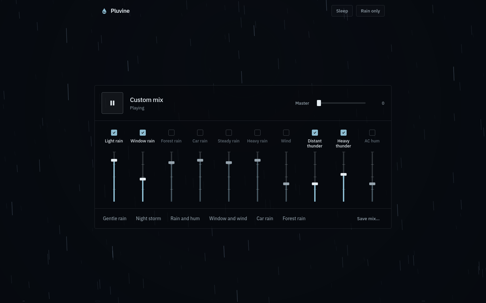

# Pluvine

A desktop ambient rain mixer. One window with ten sound layers — rain, wind,
thunder, and air-conditioner hum — each with its own on/off switch and level.
There are presets, a sleep timer, master volume, and lightning in the
background. No accounts, no streaming, no internet connection needed.



## Install (Arch Linux)

```bash
cd packaging/aur-bin && makepkg -si
```

The tarball comes from the releases page with a sha256 check, and the
package uses the system `electron` package. The AUR package `pluvine-bin`
is prepared but not published yet.

For other setups, build an AppImage or a pacman package with
`npm run dist:linux`.

## Run from source

```bash
npm install
npm run dev        # http://localhost:3000
```

## Checks

```bash
npm run lint            # TypeScript check
npm test                # engine tests (30 tests)
npm run build           # production bundle
node verify.browser.mjs # 84 checks in Firefox
node verify.electron.mjs # 24 checks in the desktop app
```

More detail: `docs/electron-arch.md` (packaging), `docs/audio-engine.md`
(engine), `sounds/README.md` (recordings).

## License

No license file is shipped. The package metadata uses `LicenseRef-Proprietary`.
